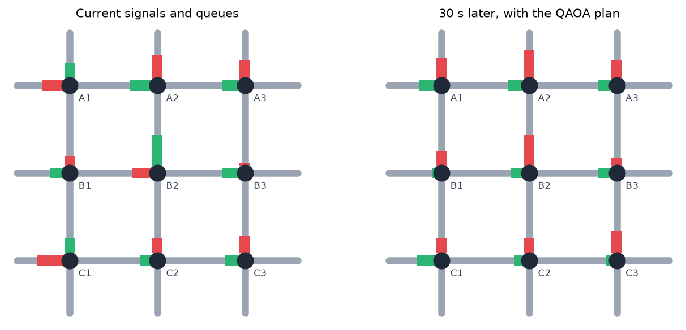
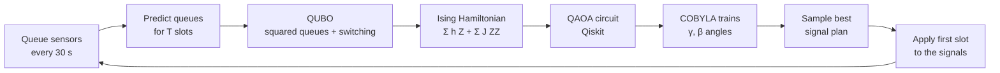
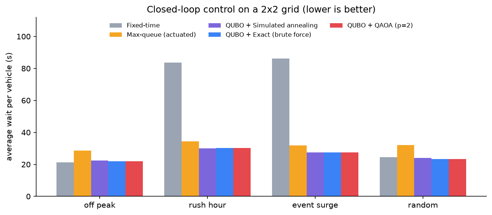
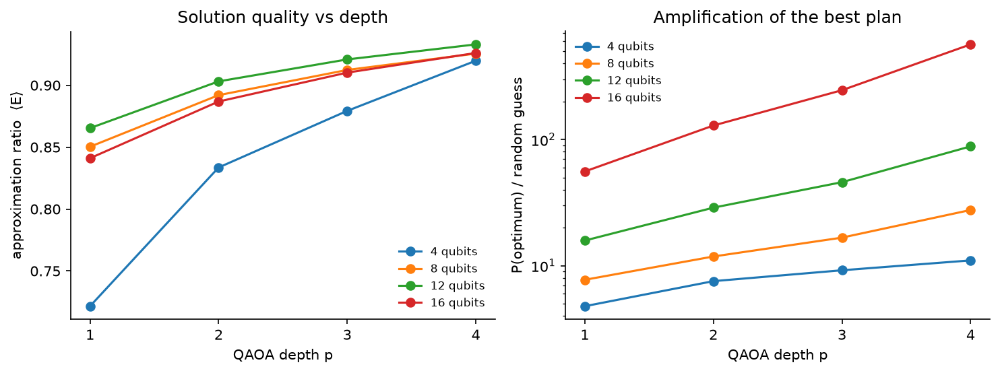
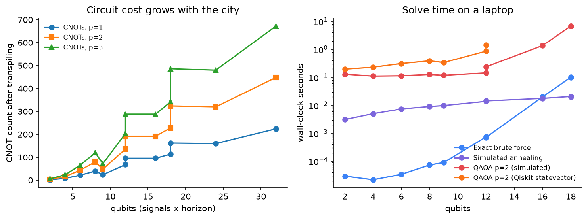
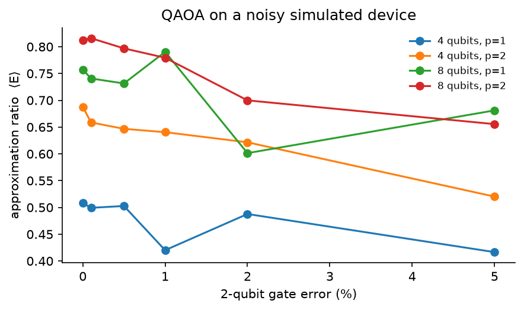

# 🚦⚛️ Quantum-Assisted Traffic Signal Optimization Using QAOA

[](https://github.com/Harshithk00/Vhack/actions/workflows/tests.yml)


> Can a quantum optimizer decide when a city's traffic lights turn green?

Urban congestion costs travel time, fuel and clean air. This project models a grid
of traffic signals as a **combinatorial optimization problem (QUBO)**, solves it with
the **Quantum Approximate Optimization Algorithm (QAOA)** in **Qiskit**, and runs it as
a live controller in a traffic simulation. It is compared with fixed-time signals,
actuated control, simulated annealing and exact brute force under four traffic
conditions, and we measure solution quality, circuit cost, scalability and the
effect of hardware noise.



## Try it live

| | |
|---|---|
| 🎬 **Demo video** (4 min, plus a 1.5-min pitch) | [vhack.harshithk.tech](https://vhack.harshithk.tech) |
| 🚦 **Live dashboard** (QAOA running on our server) | [qtraffic.harshithk.tech](https://qtraffic.harshithk.tech) |
| 🖼️ **Poster and slides** | [`presentation/`](presentation/) |

## Highlights

- **One qubit = one signal in one 30-second slot.** A 2x2 grid planned one minute
  ahead is an 8-qubit problem with 256 possible plans.
- **Green waves emerge** from the physics: squaring the predicted queues couples
  neighbouring signals, so nothing is hand-coded.
- **QAOA control cuts average wait by 64% vs fixed-time signals at rush hour**
  (83.5 s to 30.2 s) and by 12% vs actuated control, matching the exact optimum.
- **Solution quality improves with depth p**: approximation ratio 0.85 → 0.93 from
  p = 1 to 4, and the optimal plan becomes up to 600x more likely than a random guess.
- **Three Qiskit backends**: exact statevector, a vectorised simulator validated
  against it, and **Aer with depolarizing noise**.
- **Interactive Streamlit dashboard**, a terminal demo, a reproducible benchmark
  suite, 26 tests and CI.

## How it works



**Variables.** `x[i,t] = 1` if intersection `i` shows east-west green in slot `t`,
`0` for north-south green.

**Cost.**

```
E(x) = Σ_{i,t} ( Q_ns[i,t]² + Q_ew[i,t]² )   +   w_s · Σ_{i,t} [ x[i,t] ≠ x[i,t-1] ]
         └── predicted queues (linear in x) ──┘    └── amber / all-red lost time ──┘
```

Each predicted queue = current queue + arrivals − vehicles served on our green +
platoons released by the upstream signal. Squaring it creates the quadratic
couplings that make the problem hard (and QAOA-shaped). Full derivation:
[docs/FORMULATION.md](docs/FORMULATION.md).

**QAOA.** `RZ(2γh)` on every qubit, `RZZ(2γJ)` on every coupled pair, `RX(2β)` mixer,
`p` layers. Angles are trained layer by layer (INTERP initialisation), with a plain
or CVaR objective, then the circuit is sampled and the cheapest plan is applied.
In closed loop the previous slot's angles warm-start the next solve.

## Results

All numbers come from `python benchmarks/run_benchmarks.py`
(full tables in [results/summary.md](results/summary.md)).

### Closed-loop control: average wait per vehicle (s), 2x2 grid, 30 min, 3 seeds

| Scenario | Fixed-time | Actuated (max-queue) | QUBO + SA | QUBO + Exact | **QUBO + QAOA p=2** |
|---|---:|---:|---:|---:|---:|
| Off-peak | 21.3 | 28.6 | 22.4 | 21.9 | **21.9** |
| Rush hour | 83.5 | 34.5 | 30.0 | 30.2 | **30.2** |
| Event surge | 86.2 | 31.8 | 27.5 | 27.6 | **27.6** |
| Random demand | 24.4 | 32.0 | 24.0 | 23.4 | **23.4** |



The optimised controller never loses badly: in light, balanced traffic it ties
fixed-time timing, and under imbalance it beats both classical baselines. The SA
plan sometimes helps by luck: the QUBO is a model of the traffic, not the
simulator itself.

### QAOA solution quality



| Qubits | p=1 ratio | p=4 ratio | Found optimum (p=2) | SA found optimum |
|---:|---:|---:|---:|---:|
| 4 | 0.72 | 0.92 | 100% | 100% |
| 8 | 0.85 | 0.93 | 100% | 89% |
| 12 | 0.87 | 0.93 | 100% | 83% |
| 16 | 0.84 | 0.93 | 78% | 56% |

### Scalability and noise





### Findings and limitations

- QAOA is a **correct and competitive optimizer** for this problem in simulation,
  and with sampling (p ≥ 2) it finds the optimum more often than our simulated-annealing baseline on the same instances.
- **No quantum speed-up at this size**: brute force solves 18 qubits in 0.1 s, while
  simulating QAOA takes seconds. The point of the study is feasibility.
- **P(optimum) shrinks exponentially** with problem size even as the
  approximation ratio holds, so larger cities need more shots or deeper circuits.
- **Circuit cost grows with couplings**: a 4x4 grid planned 1 min ahead needs 32
  qubits and about 450 CNOTs at p = 2, beyond what today's noisy devices handle
  reliably. Gate noise above about 1-2% visibly degrades the result.
- **Path to scale**: decompose a city into corridors or sub-grids that each fit on
  a device, and run them on IBM Quantum via Qiskit Runtime.

## Quick start

```bash
git clone https://github.com/Harshithk00/Vhack.git && cd Vhack
python3 -m venv .venv && source .venv/bin/activate
pip install -r requirements.txt
```

| What | Command |
|---|---|
| Interactive dashboard | `streamlit run app/streamlit_app.py` |
| Terminal demo | `python -m qtraffic.demo --scenario rush_hour` |
| Noisy hardware-like run | `python -m qtraffic.demo --backend aer --noise 0.01` |
| Full benchmark study (~5 min) | `python benchmarks/run_benchmarks.py` |
| Quick benchmark smoke test | `python benchmarks/run_benchmarks.py --quick` |
| Tests | `pytest` |
| Run the dashboard in Docker | `docker build -t qtraffic . && docker run -p 8501:8501 qtraffic` |

Use it as a library:

```python
from qtraffic import make_scenario, TrafficSimulator, build_signal_problem, QAOASolver

net = make_scenario("rush_hour", rows=2, cols=2)
problem = build_signal_problem(net, TrafficSimulator(net).initial_state(), horizon=2)
result = QAOASolver(reps=2).solve(problem.qubo)
print(problem.decode(result.x))       # signal plan: rows = slots, cols = intersections
```

## Project structure

```
qtraffic/
  network.py       grid of signalised intersections
  scenarios.py     off-peak, rush hour, event surge, random demand
  simulator.py     stochastic queue simulator and metrics
  formulation.py   traffic → QUBO (predicted queues, switching penalty)
  qubo.py          QUBO container, Ising / SparsePauliOp mapping
  classical.py     exact brute force, simulated annealing
  qaoa.py          QAOA ansatz, training, backends (statevector / fast / Aer + noise)
  policies.py      fixed-time, actuated, QUBO model-predictive controller
  viz.py           shared figures
  demo.py          terminal demo
app/streamlit_app.py      interactive dashboard
benchmarks/run_benchmarks.py   the full study → results/
docs/              formulation, team pitch script, judge Q&A
presentation/      Fall Fest poster (.pptx/.pdf) and 5-slide deck
Dockerfile         container for the live dashboard
tests/             26 tests (QUBO maths, Ising mapping, QAOA, simulator)
```

## Built in phases

| Phase | What |
|---|---|
| 1 | Traffic network, scenarios, queue simulator, classical baselines |
| 2 | QUBO formulation, Ising mapping, exact and annealing solvers, MPC controller |
| 3 | QAOA in Qiskit: ansatz, INTERP training, CVaR, warm start, Aer noise |
| 4 | Benchmark suite: closed loop, quality vs depth, scalability, noise |
| 5 | Streamlit dashboard |
| 6 | Docs, terminal demo, CI |

## References

1. E. Farhi, J. Goldstone, S. Gutmann, *A Quantum Approximate Optimization Algorithm*, arXiv:1411.4028 (2014).
2. L. Zhou et al., *Quantum Approximate Optimization Algorithm: Performance, Mechanism, and Implementation on Near-Term Devices*, PRX 10, 021067 (2020).
3. P. Barkoutsos et al., *Improving Variational Quantum Optimization using CVaR*, Quantum 4, 256 (2020).
4. A. Lucas, *Ising formulations of many NP problems*, Frontiers in Physics 2, 5 (2014).
5. Qiskit contributors, *Qiskit: An Open-source Framework for Quantum Computing*.

## Team NULL POINTER

Department of Computer Science & Engineering, SIT Tumkur

| Member | Role |
|---|---|
| **Harshit Kumar** | Team Lead |
| Himansu Rauniyar | Team Member |
| Aditya Pattar | Team Member |

## License

MIT, see [LICENSE](LICENSE).
